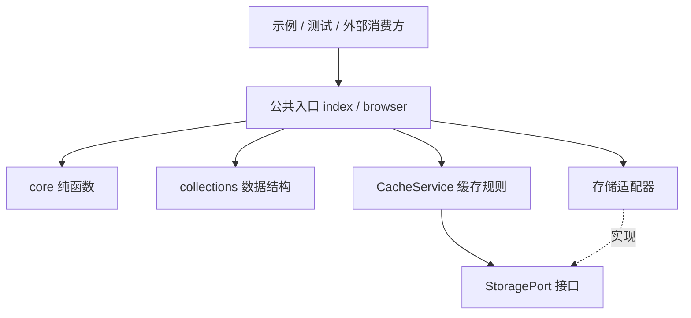

# 架构：用小工具库学习清晰边界

## 为什么是单包

当前只有一组工具、一套运行约定和一个维护单元。单包即可练习真实工程链路，先不引入多应用工作区、任务编排与发布平台。未来出现不同消费方或独立发版需求时再拆包。

## 依赖方向



| 模块 | 职责 | 约束 |
| --- | --- | --- |
| core | 确定性计算、参数验证 | 不依赖环境、服务或可变全局 |
| collections | 管理内存中的有状态数据结构 | 状态封装在实例内 |
| ports | 描述服务所需的最小外部能力 | 只有接口，不绑定具体实现 |
| services | TTL、缓存格式、外部数据验证 | 依赖接口，不依赖浏览器或具体存储类 |
| adapters | 将环境能力适配为统一接口 | 不放业务缓存规则 |
| 公共入口 | 明确可消费的 API | 不导入示例、测试或 legacy |

模块内部可以相对导入，消费方统一从 `bi-utils` 或 `bi-utils/browser` 导入。`package.json` 的 exports 限制外部深层导入，内部目录可以重构而不扩大公共契约。主入口与浏览器子入口导入时都不读取浏览器全局。

## 三个核心设计选择

### 用接口替代具体环境

CacheService 需要的只是 getItem/setItem/removeItem。MemoryStorage 与浏览器 Storage 都可满足这份契约。构造函数注入依赖即可，不需要反射或 DI 框架。

### 把时间作为依赖

默认时钟是 Date.now，测试通过 `now` 注入固定值。边界规则为 `now >= expiresAt` 即过期，TTL 单位始终是毫秒，0 表示立即过期。测试无需 sleep，执行更快且稳定。

### 在数据边界做运行时验证

JSON.parse 的结果先视为 unknown。版本、过期时间和值校验通过后才能返回 T。格式损坏或过期会清除记录并返回 null；配额、权限等存储故障向调用方抛出，不伪装成缓存未命中。值校验器应是无副作用的类型守卫，业务复杂对象需要完整字段校验。

## 工程链路

```text
src/*.ts
   │ tsc：类型检查与编译（出错不生成新产物）
   ▼
dist/*.js + *.d.ts + maps
   ├── tests/*.test.mjs：通过公共入口验证产物
   └── examples/demo.mjs：消费方视角的集成示例
```

NodeNext 按 Node 的模块规则解析文件；源码相对 import 写 `.js`，TypeScript 在开发期解析对应 `.ts`，编译后保持可被 Node 直接执行的路径。使用 `.ts` 路径或省略扩展名会掩盖真实运行环境约束。

构建前清理 dist，防止已删除模块残留。锁文件固定开发依赖，CI 与本地执行相同命令。`private: true` 防止将教学包误发布。

## 后续扩展

先为边界写失败测试，再新增小模块，通过公共入口导出，最后添加消费示例。只有出现真实需求时才增加异步接口、IndexedDB 适配、浏览器 E2E、独立包、lint 平台或发布工具。同步 StoragePort 不适合直接套在远程数据库上，异步存储应单独设计 Promise 契约。
